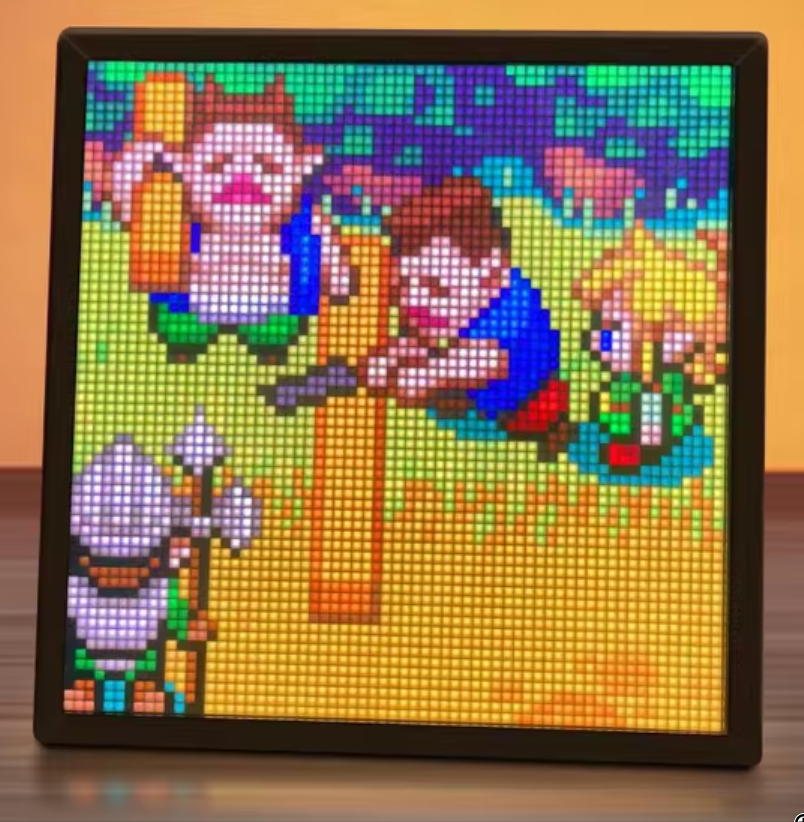
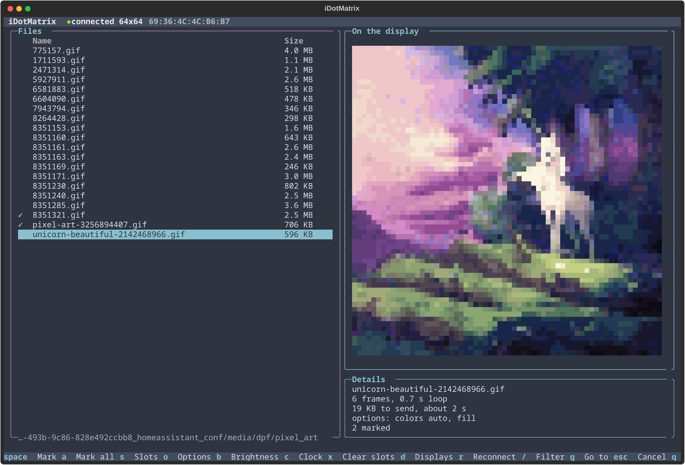

<br/>
<p align="center">
  <a href="https://github.com/markusressel/idotmatrix-api-client">
    
  </a>

<h3 align="center">idotmatrix-api-client</h3>

  <p align="center">
    Control 16x16, 32x32 and 64x64 sized iDotMatrix Pixel Displays
  </p>

  <p align="center">
    
    
  </p>
</p>

## Features



A library to control displays like the one on the right without the official
[iDotMatrix](https://play.google.com/store/apps/details?id=com.tech.idotmatrix&pli=1) app, based on its reverse engineered
Bluetooth protocol.

Looking for Home Assistant? The [ha-idotmatrix](https://github.com/markusressel/ha-idotmatrix) integration is built on
this library.

* Show photos, animated GIFs and pixel art, with text on top, or store them in the slots of the device so that it
  cycles through them on its own
* Clock, countdown, chronograph, scoreboard, graffiti board, effects and a full screen color
* Scrolling text with the bundled pixel fonts
* Music sync with the microphone of the device
* Brightness, eco mode, power and time
* Digital picture frame for a folder of pictures
* Terminal UI to try all of it
* Works with the 16x16, 32x32 and 64x64 displays, with `bleak` or with the Bluetooth stack of Home Assistant

Open ends (alarm and buzzer, the cloud API, password protection, firmware update) are collected in the
[device protocol notes](docs/DEVICE-PROTOCOL.md#not-understood-yet).

<br clear="right"/>

## Getting Started

You need Python 3.12 or newer and a display that works with the iDotMatrix app (Windows may work but is untested).

### Terminal UI

The quickest way to try your display: browse a folder, preview how pictures and animations look on the display, send
them, and control its features, with a pixel editor.



```sh
pip install 'idotmatrix-api-client[tui]'
idotmatrix-tui /path/to/pictures
```

See the [TUI notes](docs/TUI.md) for the keys and options.

### API Client

To control the display from your own code, install the library and use the `IDotMatrixClient`:

```sh
pip install idotmatrix-api-client
```

```python
import asyncio

from idotmatrix import IDotMatrixClient, ScreenSize


async def main():
    client = IDotMatrixClient(screen_size=ScreenSize.SIZE_64x64)
    await client.connect()  # connects to the first iDotMatrix display it finds

    await client.set_brightness(50)
    await client.text.show_text("Hello World!")
    await client.image.show_image_file("photo.jpg")


asyncio.run(main())
```

The [examples](./examples) show more: GIFs, labels, effects, and storing files in the slots of the device.

#### Digital Picture Frame

The `DigitalPictureFrame` class builds on the client and shows images and GIFs as a slideshow. It can

* display a static list of images and/or GIFs
* watch one or more directories for images and GIFs
* automatically reconnect to the device in case of an error or connection loss

See [examples/example_digital_picture_frame.py](./examples/example_digital_picture_frame.py) for how to use it.

#### Home Assistant and other Bluetooth stacks

If something else owns the Bluetooth stack, like Home Assistant with its scanner and Bluetooth proxies, see the
[integration notes](docs/INTEGRATION.md).

## Fonts

Text is drawn in 1-bit cells without anti-aliasing, so pixel fonts work best. The package bundles a selection that was
tested at fixed `font_size` values. See the [font notes](docs/FONTS.md) for the sizes, licenses and how to add more.

## Helpful Links

* This project
  * [idotmatrix-api-client on PyPI](https://pypi.org/project/idotmatrix-api-client/)
  * [Device protocol notes](docs/DEVICE-PROTOCOL.md): what is known about the Bluetooth protocol of the displays
* Related projects
  * [ha-idotmatrix](https://github.com/markusressel/ha-idotmatrix): Home Assistant integration built on this library
  * [derkalle4/python3-idotmatrix-library](https://github.com/derkalle4/python3-idotmatrix-library): the original
    project this is a fork of
  * [8none1/idotmatrix](https://github.com/8none1/idotmatrix): further notes and tools for the displays
  * [fbnlrz/homeyidotmatrix](https://github.com/fbnlrz/homeyidotmatrix): Homey integration with protocol notes
* The official [iDotMatrix app](https://play.google.com/store/apps/details?id=com.tech.idotmatrix) (Android)
* Create images or GIFs
  * [pixilart](https://www.pixilart.com/draw): create a new drawing and select a preset for the size of your display
    (e.g. 64x64)

## Other Hardware
This software is specifically built for devices which are supported by the iDotMatrix app. There are other devices
being sold which have a similar form factor and claim to be compatible, but which are not.  Below is a list of known
non-iDotMatrix-compatible hardware and associated software.
- For hardware supported by the "LOY SPACE" app: https://github.com/eskibars/popledder/

## Contributing

GitHub is for social coding: if you want to write code, I encourage contributions through pull requests from forks
of this repository. Create GitHub tickets for bugs and new features and comment on the ones that you are interested in.

To work on the library, see the [development notes](docs/DEVELOPMENT.md).

## License

Distributed under the GNU GENERAL PUBLIC License.
See [LICENSE](https://github.com/markusressel/idotmatrix-api-client/blob/main/LICENSE) for more information.

## Differences From The Original Project

This is a fork of [derkalle4/python3-idotmatrix-library](https://github.com/derkalle4/python3-idotmatrix-library),
which is no longer maintained. The fork continues its development and maintenance.

The API is not compatible with the original: the structure was reworked for usability and maintainability, so code
written for the original needs some adjustments to run with this library. Returning the raw bytearray data of commands
was dropped to keep the library simple.

## Acknowledgements

Original project by [derkalle4](https://github.com/derkalle4) and [jmgraeffe](https://github.com/jmgraeffe).

* [Othneil Drew](https://github.com/othneildrew/Best-README-Template) - *README Template*
* [LordRippon](https://github.com/LordRippon) - *Reverse Engineering for the Displays*
* [8none1](https://github.com/8none1) - *Reverse Engineering for the Displays*
* [schorsch3000](https://github.com/schorsch3000) - *smaller fixes*
* [tekka007](https://github.com/tekka007) - *code refactoring and reverse engineering*
* [inselberg](https://github.com/inselberg) - *Reverse Engineering for the Displays*
